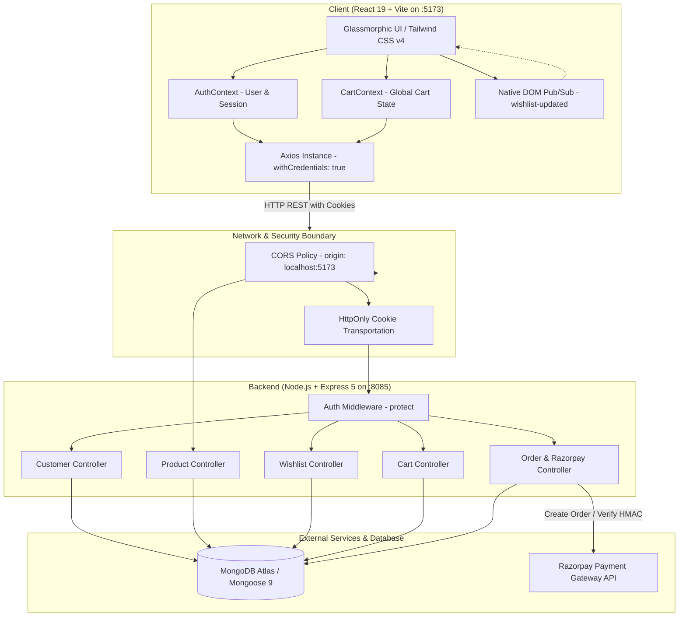
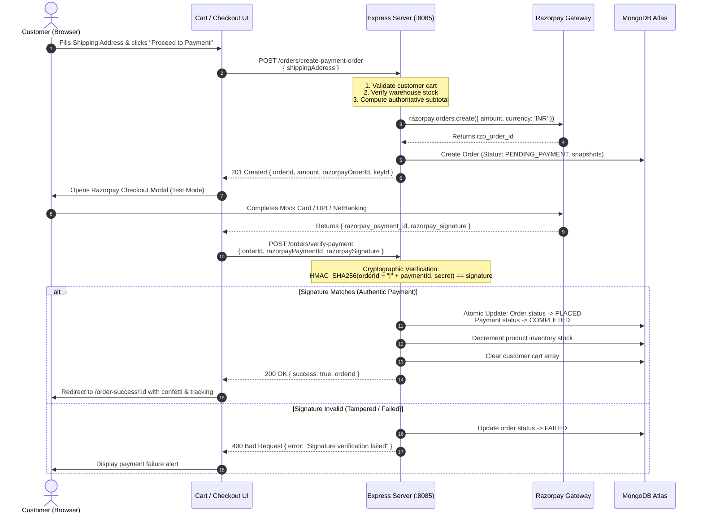

# 🛒 ShopKart — Fullstack E-Commerce & Payment Engineering Platform

<div align="center">


[](https://react.dev/)
[](https://vitejs.dev/)
[](https://tailwindcss.com/)
[](https://nodejs.org/)
[](https://expressjs.com/)
[](https://www.mongodb.com/)
[](https://razorpay.com/)
[](https://jwt.io/)

**A modern, production-grade fullstack e-commerce application featuring decoupled React 19 architecture, real-time wishlist synchronization, persistent shopping cart management, server-authoritative checkout, and cryptographic Razorpay payment verification.**

[Explore Features](#-key-features) • [System Architecture](#-system-architecture) • [Getting Started](#-getting-started) • [API Reference](#-api-reference) • [Security & Design Patterns](#-security--engineering-principles)

</div>

---

## 📌 Table of Contents

- [Overview & Architecture](#-overview--architecture)
- [System Architecture](#-system-architecture)
  - [High-Level Data Flow](#high-level-data-flow)
  - [End-to-End Checkout & Payment Lifecycle](#end-to-end-checkout--payment-lifecycle)
- [Key Features](#-key-features)
  - [1. Authentication & Session Security](#1-authentication--session-security)
  - [2. Catalog, Search & Filtering](#2-catalog-search--filtering)
  - [3. Real-Time Wishlist System](#3-real-time-wishlist-system)
  - [4. Shopping Cart & Inventory Guarding](#4-shopping-cart--inventory-guarding)
  - [5. Checkout & Razorpay Integration](#5-checkout--razorpay-integration)
  - [6. Immutable Order Snapshots & History](#6-immutable-order-snapshots--history)
- [Directory Structure](#-directory-structure)
- [Database Models & Schema Design](#-database-models--schema-design)
- [API Reference](#-api-reference)
- [Environment Variables](#-environment-variables)
- [Getting Started](#-getting-started)
  - [Prerequisites](#prerequisites)
  - [Step 1: Clone the Repository](#step-1-clone-the-repository)
  - [Step 2: Server Setup & Configuration](#step-2-server-setup--configuration)
  - [Step 3: Seed Catalog Data](#step-3-seed-catalog-data)
  - [Step 4: Client Setup & Execution](#step-4-client-setup--execution)
- [Security & Engineering Principles](#-security--engineering-principles)
- [Laboratory Roadmap (Lab 01 to Lab 06)](#-laboratory-roadmap)

---

## 🚀 Overview & Architecture

**ShopKart** was engineered to simulate enterprise e-commerce requirements:
1. **Decoupled Client-Server Boundary**: A single-page application built on React 19 + Vite communicating with an Express 5 REST API over CORS.
2. **Zero-Trust Financial Architecture**: Client price and stock totals are treated as untrusted hints. Every currency calculation, discount, subtotal, and tax computation is recalculated server-side during checkout.
3. **Stateless Authentication with Stateful Delivery**: JSON Web Tokens (JWT) signed with HMAC SHA-256 are dispatched via browser `HttpOnly` cookies, combining stateless token verification with immunity against XSS token harvesting.
4. **Historical Immutability**: Orders preserve point-in-time product snapshots (`name`, `price`, `image`, `quantity`), ensuring historical accuracy even if merchant catalog prices change or products are discontinued.

---

## 🏗️ System Architecture

### High-Level Data Flow



---

### End-to-End Checkout & Payment Lifecycle



---

## ✨ Key Features

### 1. Authentication & Session Security
- **Registration & Validation**: Strict regex rules validate 10-digit mobile numbers, canonical email format, and password minimum strength.
- **Bcrypt Hashing**: One-way adaptive salted password hashing with 10 salt rounds ($2^{10} = 1024$ iterations).
- **HttpOnly JWT Cookies**: Signed with expiration of 7 days; completely unreachable from `document.cookie` to prevent cross-site scripting (XSS) leaks.
- **Hydration on Load**: [AuthContext.jsx](file:///home/kskroyal/Projects/ShopKart/client/src/context/AuthContext.jsx) silently pings `GET /customers/me` on boot to restore sessions without showing authentication flicker.
- **Route Guards**:
  - `ProtectedRoute`: Prevents unauthenticated access to home, products, wishlist, cart, checkout, and orders.
  - `PublicRoute`: Prevents logged-in customers from accessing login or registration pages.

---

### 2. Catalog, Search & Filtering
- **Dynamic Search Bar**: Real-time debounce query filtering over product names and descriptions.
- **Category Filtering**: Instant switching between All Categories, Electronics, Fashion, Accessories, Footwear, etc.
- **Inventory Visibility**: Real-time stock status pills (`In Stock`, `Low Stock: X left`, `Out of Stock`).
- **Product Details View**: Comprehensive inspection page featuring high-res imagery, specifications, live stock counters, and direct add-to-cart/wishlist triggers.

---

### 3. Real-Time Wishlist System
- **Decoupled Architecture**: Built without heavy state libraries, leveraging browser-native DOM custom events (`CustomEvent('wishlist-updated')`).
- **Synchronized Heart Icons**: Toggling an item on a card instantly updates the navigation bar badge and other active cards across the viewport.
- **Database Reference Model**: Items are persisted in the customer's document as an array of `ObjectId` references to the `Product` collection, hydrated dynamically with Mongoose `.populate()`.

---

### 4. Shopping Cart & Inventory Guarding
- **Global Context Provider**: [CartContext.jsx](file:///home/kskroyal/Projects/ShopKart/client/src/context/CartContext.jsx) exposes unified cart operations (`addToCart`, `updateQuantity`, `removeFromCart`, `clearCart`).
- **Inventory Guardrails**: Prevents incrementing quantities beyond available warehouse stock levels with immediate UI toast warnings.
- **Derived Financials**: Dynamic client recalculation of `subtotal`, `shippingFee`, `estimatedTax`, and `totalAmount` for immediate visual feedback.
- **Zero Drift**: State is permanently stored in MongoDB, allowing customers to switch devices or refresh the browser without losing their cart contents.

---

### 5. Checkout & Razorpay Integration
- **Shipping Address Validation**: Multi-field input verification (recipient name, 10-digit phone, street, city, state, 6-digit postal code).
- **Server Authoritative Pricing**: The backend recalculates line items and totals directly from the database, ignoring any tampering from the client request payload.
- **Razorpay Modal Checkout**: Seamless popup overlay loaded via official CDN script with pre-filled customer email and phone number.
- **Cryptographic Signature Verification**: Uses Node.js `crypto` with `HMAC-SHA256` to independently authenticate that payment was verified by Razorpay servers:
  $$\text{Signature} = \text{HMAC-SHA256}(\text{order\_id} + "|" + \text{payment\_id},\, \text{RAZORPAY\_KEY\_SECRET})$$

---

### 6. Immutable Order Snapshots & History
- **Point-in-Time Order Snapshots**: Orders store full copies of product attributes (`name`, `price`, `image`, `quantity`) at purchase time. Future product price updates will never alter historical invoice records.
- **Order State Machine**:
  ```
  [ PENDING_PAYMENT ] ──(Verification Success)──► [ PLACED ] ──► [ CONFIRMED ] ──► [ SHIPPED ] ──► [ DELIVERED ]
           │
           └──(Verification Failed / Cancelled)──► [ FAILED ]
  ```
- **Orders Portal**: Customers can view past purchases, inspect itemized summaries, view delivery addresses, check payment IDs, and track live status pills.

---

## 📂 Directory Structure

```text
ShopKart/
├── client/                               # Frontend Single Page App (React 19 + Vite)
│   ├── public/                           # Static public assets
│   ├── src/
│   │   ├── assets/                       # Local icons and media
│   │   ├── components/                   # Reusable UI building blocks
│   │   │   ├── CartItem.jsx              # Interactive cart item row with quantity controls
│   │   │   ├── LoadingScreen.jsx         # Full-page animated loading spinner
│   │   │   ├── Navbar.jsx                # Responsive navbar with live Wishlist & Cart badges
│   │   │   ├── ProductCard.jsx           # Catalog product card with heart & cart triggers
│   │   │   ├── ProtectedRoute.jsx        # Navigation guard for authenticated routes
│   │   │   ├── PublicRoute.jsx           # Navigation guard for guest routes (login/register)
│   │   │   ├── SearchBar.jsx             # Debounced product search input
│   │   │   └── WishlistCard.jsx          # Dedicated wishlist item card
│   │   ├── context/                      # Global React Context providers
│   │   │   ├── AuthContext.jsx           # User authentication state & session hydration
│   │   │   └── CartContext.jsx           # Global shopping cart state & derived calculations
│   │   ├── pages/                        # Route view pages
│   │   │   ├── Cart.jsx                  # Shopping cart overview & cost summary
│   │   │   ├── Checkout.jsx              # Shipping form & Razorpay payment orchestrator
│   │   │   ├── Home.jsx                  # Customer account dashboard & profile
│   │   │   ├── Login.jsx                 # Customer login portal
│   │   │   ├── Orders.jsx                # Historical orders list & status tracker
│   │   │   ├── OrderSuccess.jsx          # Post-checkout confirmation & receipt
│   │   │   ├── ProductDetails.jsx        # Full product specification & gallery
│   │   │   ├── Products.jsx              # Product catalog with category & text filters
│   │   │   ├── Register.jsx              # New customer account registration
│   │   │   └── Wishlist.jsx              # Saved items grid with quick add-to-cart
│   │   ├── services/
│   │   │   └── api.js                    # Configured Axios instance (baseURL + credentials)
│   │   ├── App.jsx                       # Application router & route definitions
│   │   ├── index.css                     # Tailwind CSS v4 design tokens & utilities
│   │   └── main.jsx                      # React DOM root entry point
│   ├── eslint.config.js                  # ESLint configuration
│   ├── index.html                        # HTML entry point with Razorpay CDN script
│   ├── package.json                      # Client dependencies & scripts
│   └── vite.config.js                    # Vite bundler configuration
│
└── server/                               # Backend REST API (Node.js + Express 5)
    ├── config/
    │   └── razorpay.js                   # Razorpay SDK initialization
    ├── controllers/                      # Route business logic & DB operations
    │   ├── cart.controller.js            # Cart add, update, remove, and get operations
    │   ├── customer.controller.js        # Auth, registration, profile, and logout
    │   ├── order.controller.js           # Checkout, payment creation & verification
    │   ├── product.controller.js         # Product catalog queries & details
    │   └── wishlist.controller.js        # Wishlist add, remove, and toggle
    ├── middlewares/
    │   └── auth.middleware.js            # JWT verification & customer context injector
    ├── models/                           # Mongoose data schemas
    │   ├── customer.model.js             # Customer schema with embedded cart & wishlist refs
    │   ├── order.model.js                # Order schema with immutable item snapshots
    │   └── product.model.js              # Product catalog schema
    ├── routes/                           # Express modular route definitions
    │   ├── cart.routes.js                # /cart endpoints
    │   ├── customer.routes.js            # /customers endpoints
    │   ├── order.routes.js               # /orders endpoints
    │   ├── product.routes.js             # /products endpoints
    │   └── wishlist.routes.js            # /wishlist endpoints
    ├── seeds/
    │   └── seedProducts.js               # Database seeder with sample e-commerce catalog
    ├── utils/
    │   └── generateToken.js              # JWT signer & HttpOnly cookie setter
    ├── index.js                          # Express server entry point & middleware pipeline
    └── package.json                      # Server dependencies & scripts
```

---

## 🗄️ Database Models & Schema Design

### Customer Model (`server/models/customer.model.js`)
```javascript
{
  fullName: { type: String, required: true },
  email:    { type: String, required: true, unique: true },
  password: { type: String, required: true },
  phone:    { type: String, required: true },
  wishlist: [{ type: mongoose.Schema.Types.ObjectId, ref: "Product" }],
  cart: [
    {
      product:  { type: mongoose.Schema.Types.ObjectId, ref: "Product", required: true },
      quantity: { type: Number, default: 1, min: 1 }
    }
  ]
}
```

### Product Model (`server/models/product.model.js`)
```javascript
{
  name:        { type: String, required: true },
  description: { type: String, required: true },
  price:       { type: Number, required: true },
  category:    { type: String, required: true },
  image:       { type: String, required: true },
  stock:       { type: Number, required: true, default: 0 }
}
```

### Order Model (`server/models/order.model.js`)
```javascript
{
  customer: { type: mongoose.Schema.Types.ObjectId, ref: "Customer", required: true },
  items: [
    {
      product:  { type: mongoose.Schema.Types.ObjectId, ref: "Product" },
      name:     { type: String, required: true },
      price:    { type: Number, required: true },
      image:    { type: String, required: true },
      quantity: { type: Number, required: true }
    }
  ],
  totalAmount: { type: Number, required: true },
  shippingAddress: {
    fullName: { type: String, required: true },
    phone:    { type: String, required: true },
    street:   { type: String, required: true },
    city:     { type: String, required: true },
    state:    { type: String, required: true },
    pincode:  { type: String, required: true }
  },
  paymentStatus:     { type: String, enum: ["PENDING", "COMPLETED", "FAILED"], default: "PENDING" },
  orderStatus:       { type: String, enum: ["PLACED", "CONFIRMED", "SHIPPED", "DELIVERED"], default: "PLACED" },
  razorpayOrderId:   { type: String },
  razorpayPaymentId: { type: String }
}
```

---

## 📡 API Reference

### 🔐 Customer Authentication (`/customers`)
| Method | Endpoint | Description | Auth Required |
| :--- | :--- | :--- | :---: |
| `POST` | `/customers/register` | Create a new customer account | No |
| `POST` | `/customers/login` | Authenticate customer & set HttpOnly cookie | No |
| `GET` | `/customers/me` | Fetch currently authenticated user profile | **Yes** |
| `POST` | `/customers/logout` | Clear session cookie & terminate session | **Yes** |

### 🛍️ Products Catalog (`/products`)
| Method | Endpoint | Description | Auth Required |
| :--- | :--- | :--- | :---: |
| `GET` | `/products` | Fetch all products with category/keyword filters | No |
| `GET` | `/products/:id` | Fetch detailed single product record | No |
| `POST` | `/products` | Create product (admin / development seeding) | No |

### ❤️ Wishlist Management (`/wishlist`)
| Method | Endpoint | Description | Auth Required |
| :--- | :--- | :--- | :---: |
| `GET` | `/wishlist` | Retrieve customer wishlist with hydrated product data | **Yes** |
| `POST` | `/wishlist/:productId` | Append product ID to customer wishlist | **Yes** |
| `DELETE` | `/wishlist/:productId` | Remove product ID from customer wishlist | **Yes** |
| `PATCH` | `/wishlist/:productId/toggle` | Add if absent, remove if present (atomic toggle) | **Yes** |

### 🛒 Shopping Cart (`/cart`)
| Method | Endpoint | Description | Auth Required |
| :--- | :--- | :--- | :---: |
| `GET` | `/cart` | Fetch populated cart items and stock status | **Yes** |
| `POST` | `/cart/:productId` | Add product to cart with initial quantity | **Yes** |
| `PATCH` | `/cart/:productId` | Update item quantity (validates warehouse stock) | **Yes** |
| `DELETE` | `/cart/:productId` | Remove line item completely from cart | **Yes** |

### 💳 Orders & Payments (`/orders`)
| Method | Endpoint | Description | Auth Required |
| :--- | :--- | :--- | :---: |
| `POST` | `/orders/create-payment-order` | Validate cart, create Razorpay order & pending Order | **Yes** |
| `POST` | `/orders/verify-payment` | Verify HMAC SHA-256 signature, mark PLACED, clear cart | **Yes** |
| `GET` | `/orders` | Fetch authenticated customer's order history | **Yes** |
| `GET` | `/orders/:id` | Fetch full details for a specific order | **Yes** |
| `PATCH` | `/orders/:id/status` | Update fulfillment state (`CONFIRMED`, `SHIPPED`, etc.) | **Yes** |

---

## 🔑 Environment Variables

The server requires a `.env` file located in `server/.env` configured as follows:

```ini
# =================================================================
# DATABASE CONFIGURATION
# =================================================================
# Note: ShopKart explicitly reads process.env.dbUrl
dbUrl=mongodb+srv://<username>:<password>@cluster0.mongodb.net/shopkart?retryWrites=true&w=majority

# =================================================================
# AUTHENTICATION & SECURITY
# =================================================================
# Strong cryptographic secret for signing JSON Web Tokens
JWT_SECRET=shopkart_ultra_secure_jwt_secret_key_minimum_32_characters

# Application environment
NODE_ENV=development

# =================================================================
# PAYMENT GATEWAY (RAZORPAY TEST MODE)
# =================================================================
RAZORPAY_KEY_ID=rzp_test_yourKeyHere12345
RAZORPAY_KEY_SECRET=yourRazorpaySecretKeyHere67890
```

---

## 🛠️ Getting Started

### Prerequisites
- **Node.js**: `v18.0.0` or higher (tested on Node v20/v22)
- **npm**: `v9.0.0` or higher
- **MongoDB**: Active MongoDB Atlas cluster URI or local MongoDB instance running on `mongodb://localhost:27017/shopkart`
- **Razorpay Account**: Free [Razorpay Dashboard](https://dashboard.razorpay.com/) account for test API keys

---

### Step 1: Clone the Repository
```bash
git clone https://github.com/Aditya2514/Shopkart.git
cd Shopkart
```

---

### Step 2: Server Setup & Configuration

1. Navigate to the server directory and install dependencies:
   ```bash
   cd server
   npm install
   ```

2. Create your `.env` configuration file inside `server/` with your credentials:
   ```bash
   touch .env
   ```

3. Open `.env` and fill in your MongoDB connection string (`dbUrl`), `JWT_SECRET`, and Razorpay test credentials.

---

### Step 3: Seed Catalog Data

Populate the database with sample electronics, fashion, and lifestyle products:
```bash
node seeds/seedProducts.js
```
*Expected Output:*
```text
Connected to MongoDB
Existing products cleared.
Successfully seeded 10 sample products!
Database connection closed.
```

---

### Step 4: Run the Backend Server
```bash
npm run dev
```
*Expected Output:*
```text
DB Connection OK
Server Started on port: 8085
```

---

### Step 5: Client Setup & Execution

1. Open a new terminal window and navigate to the client folder:
   ```bash
   cd client
   npm install
   ```

2. Start the Vite development server:
   ```bash
   npm run dev
   ```

3. Open your browser and navigate to:
   ```
   http://localhost:5173
   ```

---

## 🛡️ Security & Engineering Principles

| Vulnerability Vector | Defense Mechanism in ShopKart |
| :--- | :--- |
| **Cross-Site Scripting (XSS)** | JWTs are stored exclusively inside `HttpOnly` cookies. JavaScript cannot access tokens via `document.cookie`. |
| **Cross-Site Request Forgery (CSRF)** | Strict CORS policy allowing only `http://localhost:5173` with credential verification. |
| **Credential Harvesting** | Passwords are never saved in plain text; salted with 10 rounds of `bcrypt` before persistence. |
| **Sensitive Data Exposure** | Password hashes are explicitly excluded from database query projections via `.select("-password")`. |
| **Client-Side Financial Tampering** | Frontend calculates subtotals only for display; the backend independently re-queries prices and stock from MongoDB before billing. |
| **Fake Payment Spoofing** | Payments must pass cryptographic `HMAC-SHA256` signature verification on the server before an order is placed. |
| **Catalog Drift** | Orders capture point-in-time snapshots of item prices and details to preserve historical integrity. |

---

## 🗺️ Laboratory Roadmap

```
┌─────────────────────────────────────────────────────────────────────────────┐
│                       SHOPKART EVOLUTIONARY ROADMAP                         │
├──────────────┬──────────────────────────────────────────────────────────────┤
│ Lab 01 & 02  │ Express 5 server initialization, MongoDB connection,         │
│              │ Customer Schema, bcrypt hashing, JWT in HttpOnly cookies,    │
│              │ Login/Register UI, and protected routing.                    │
├──────────────┼──────────────────────────────────────────────────────────────┤
│ Lab 03       │ Product catalog schema, search bar, category filter pills,   │
│              │ and interactive product grid.                                │
├──────────────┼──────────────────────────────────────────────────────────────┤
│ Lab 04       │ Customer wishlist system, referenced data modeling, and      │
│              │ decoupled real-time synchronization via custom DOM events.   │
├──────────────┼──────────────────────────────────────────────────────────────┤
│ Lab 05       │ Shopping cart architecture, CartContext global state, stock  │
│              │ guardrails, quantity modifiers, and persistent MongoDB cart. │
├──────────────┼──────────────────────────────────────────────────────────────┤
│ Lab 06       │ Multi-step checkout, Razorpay test mode modal integration,   │
│              │ HMAC-SHA256 signature verification, immutable snapshots,     │
│              │ and complete order history tracking.                         │
└──────────────┴──────────────────────────────────────────────────────────────┘
```

---

## 👨‍💻 Author & Acknowledgements

- **Lead Developer**: Aditya Singh ([@Aditya2514](https://github.com/Aditya2514))
- **Course**: Fullstack Web Engineering Lab Series
- **Stack**: React 19 • Vite • Express 5 • MongoDB • Tailwind CSS v4 • Razorpay

---

<div align="center">
  <sub>Built with ❤️ for scalable, secure e-commerce engineering.</sub>
</div>
